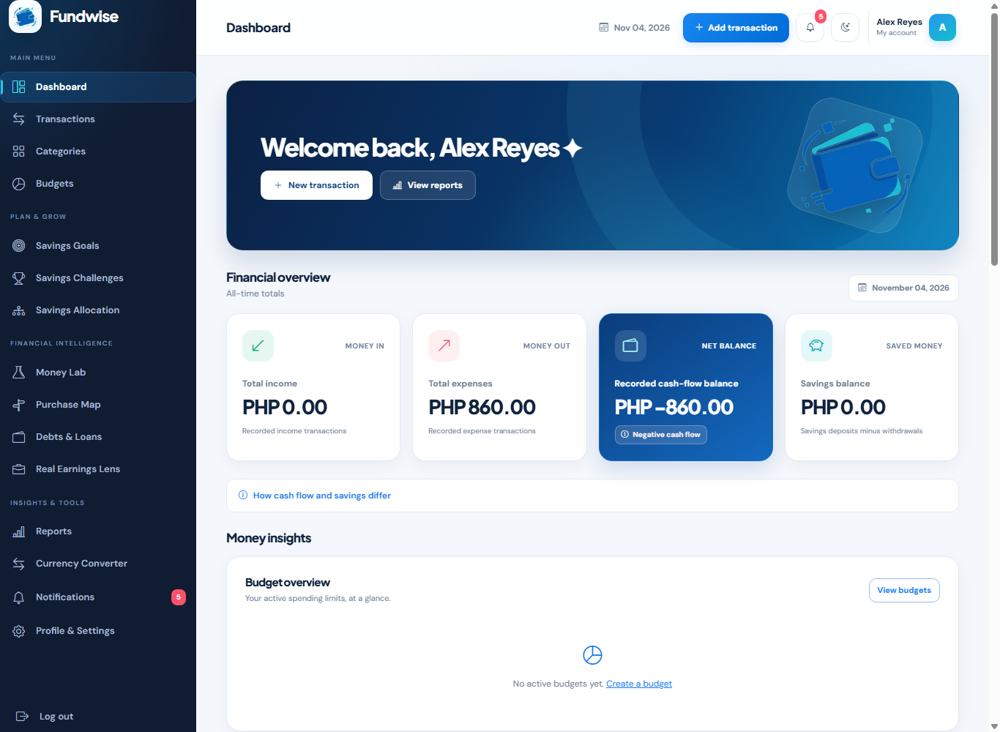
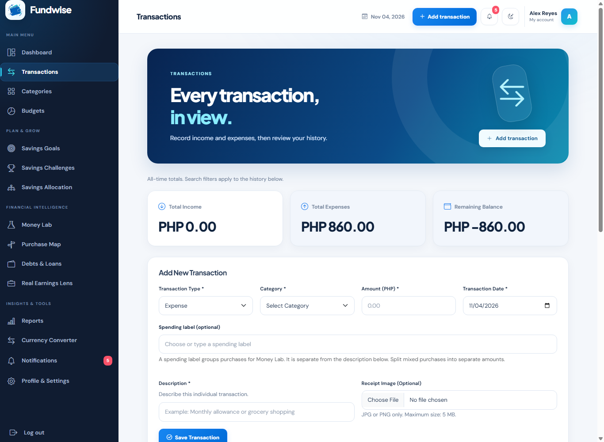
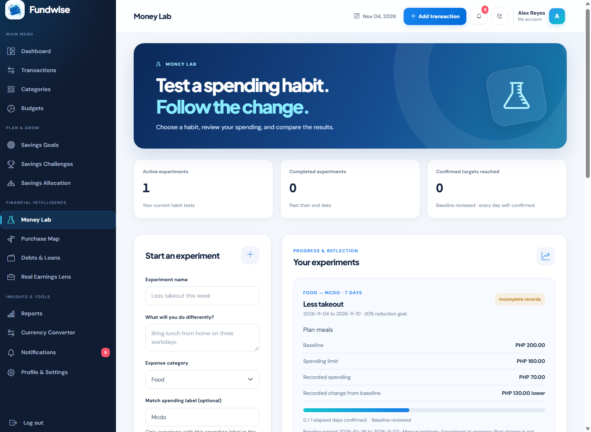
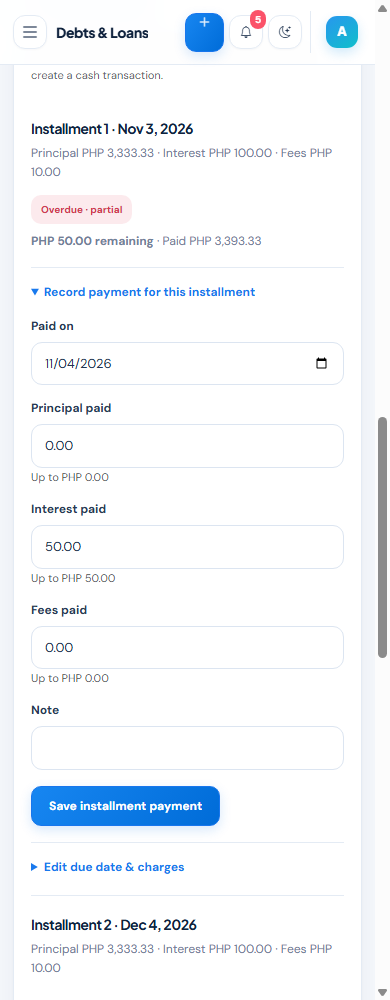

# Fundwise

**A Web-Based Income, Expense, and Savings Planning System**

Fundwise is an individual Web Systems Technology project by [Daeniel528811](https://github.com/Daeniel528811). It helps individuals record income and expenses, plan category budgets, build savings, review work earnings, and keep manual debt and loan repayments organized.

**Live application:** [fundwise-ph.free.je](https://fundwise-ph.free.je/auth/login.php)  
**Repository:** [Daeniel528811/fundwise](https://github.com/Daeniel528811/fundwise)

## Development history

The four original repository commits are retained. The missing application history was recovered on **November 5, 2026 (Asia/Manila)** from actual saved source versions and delivered update packages. Recovery commits use their real creation dates. They do not claim to have been committed during the earlier development sessions. See [recovery provenance](docs/RECOVERY_HISTORY.md) and the [changelog](CHANGELOG.md).

## Features

- Account registration, sign-in, POST logout, sessions, password changes, and recovery codes.
- User-owned categories and income/expense CRUD, search, filters, and validated private receipt uploads.
- Category budgets with overlap checks, utilization indicators, and in-app alerts.
- Savings goals, contributions/withdrawals, saving challenges linked to goals, and allocation percentages.
- Money Lab: compare a spending habit using a reviewed baseline and explicit category/label matching; inspect individual matching and unclassified records.
- Purchase Map: save conditional purchase estimates using checked balances, commitments, budgets and goal trade-offs; record a follow-up decision.
- Real Earnings Lens: itemized work costs, multiple income sources, optional work time, overnight shifts, earnings trends and reviewed links to actual transactions.
- Debts & Loans: manual principal/interest/fee payments, monthly installment plans, partial repayments, void/correction handling and per-loan reminders.
- Date-filtered PDF, XLSX and CSV reports; a reference currency converter.
- Responsive navigation, persistent light/dark theme, charts and configurable in-system reminders.

## Technology stack

| Layer | Implementation |
| --- | --- |
| Front end | Semantic HTML, CSS, Bootstrap 5, Bootstrap Icons, Chart.js |
| Interactivity | JavaScript ES6+, DOM APIs, modules, Fetch, async/await, localStorage |
| Backend | PHP 8.2+ with MySQLi/mysqlnd and Fileinfo |
| Database | MySQL/MariaDB; clean schema verified with MariaDB 10.4 |
| API | Own PHP endpoints and Frankfurter currency API |
| Hosting | InfinityFree PHP/MySQL hosting with root `htdocs` deployment |
| Version control | Git/GitHub with documented snapshot recovery |

At least three modern features are demonstrable: theme switching, validated receipt upload, in-system notifications and charts. AI inference, PWA installation and offline caching are not implemented features.

## Installation

### New installation

1. Use PHP 8.2+ and a MySQL/MariaDB server. Enable `mysqli` with mysqlnd, `fileinfo`, and PHP sessions. Apache must support the receipt folder's `.htaccess` rules. PHP's built-in server is suitable only for local testing; it does not enforce `.htaccess`.
2. Create an **empty** UTF-8 database and select it in phpMyAdmin or your SQL client.
3. Import [`database/database.sql`](database/database.sql). It contains structure only, with all 38 current tables. It creates no users or demonstration financial data. Do not import the dated migrations again after a clean installation.
4. Copy `includes/config.example.php` to `includes/config.php` and replace all connection placeholders. The app reads PHP constants from that file, not a `.env` file.
5. Set `BASE_URL` to `''` for root deployment or the actual URL subdirectory, e.g. `'/fundwise'`. Do not use the filesystem path.
6. Ensure `uploads/receipts` is writable by PHP and retains `.htaccess`. Do not grant broad permissions blindly. Verify that a direct receipt URL is denied.
7. Open `/auth/register.php`, create your own account, and save the one-time recovery code privately. There is no built-in administrator or shared default password.
8. Follow [testing instructions](docs/TESTING.md), including the exact desktop, tablet and mobile sizes in the assignment.

### Existing installation

Back up files and export the database first. Keep the live `includes/config.php` and receipt files. Follow [database migration instructions](docs/DATABASE.md); the clean `database.sql` is **not** an upgrade script. If the previous refined update is already installed, only `20261104_update2.sql` is new for Update2. Keep foreign key checks enabled.

### InfinityFree deployment

Upload application folders and `index.php` into root `htdocs`, preserving folder names. Create `includes/config.php` privately using the host's MySQL hostname, username, password and database name; use `BASE_URL=''`. Do not upload `.git`, documentation, SQL scripts, tests, raw backups or private exports to the web root. See the [deployment guide](docs/DEPLOYMENT.md).

Internet access is required for CDN fonts/icons/scripts and the public currency service. Currency conversion is a reference calculation and does not change ledger amounts. Review the [Frankfurter documentation](https://frankfurter.dev/) before changing the integration.

## Financial rules and limits

- Recorded cash-flow balance = recorded income minus recorded expenses. It can differ from actual cash when records or opening balances are missing.
- Savings and debt registers are separate. Saving contributions and debt payments do not automatically create cash transactions.
- Savings allocations are planned percentages, not transfers. Linked challenge progress uses goal deposits minus withdrawals within its dates.
- Work net = gross earned minus entered work costs. Hourly comparisons exclude sessions without time; earnings dates can differ from receipt/payment dates.
- Overnight work is grouped by the session's start date in Philippine time, including month boundaries.
- Money Lab matches a selected category and optional explicit spending label. Experiment titles and descriptions do not classify spending. Comparisons are not causal proof of behavior change.
- Loan installments use remaining principal, entered charges and manual payment confirmation. Interest rates, lender amortization, assets, net worth and loans owed **to** the user are outside scope.
- Purchase Map is conditional planning, not an affordability guarantee or an executed purchase.
- Record currency is locked after financial records exist; changing a display code must not relabel historical amounts.

## Security and privacy

Reviewed flows use password hashing, prepared queries, output escaping, CSRF tokens, ownership checks, one-time request tokens, authentication throttling and session expiry. This is a course project, not a claim of comprehensive security. [Security boundaries and review checklist](SECURITY.md).

Never publish `includes/config.php`, private keys, real account data, receipts, password hashes, recovery codes or data-bearing database exports. `.gitignore` does not remove secrets already committed. The history recovered here excludes installation configs and receipt contents.

Reminders are **in-app only**; due checks occur about once per minute while a page is visible, or when the user returns. No email, SMS or OS push is sent. Recovery uses a saved code; losing both the password and that code prevents current self-service recovery.

## Screenshots

Screenshots show synthetic local test accounts, not real customer data or proof of live deployment.

## Documentation

- [Current proposal reconstruction](docs/proposal.md) and [readable PDF](docs/proposal.pdf).
- [Six-chapter technical documentation](docs/PROJECT_DOCUMENTATION.md) and [PDF](docs/final-documentation.pdf).
- [Architecture, use cases, flowchart and ERD](docs/SYSTEM_DESIGN.md).
- [Complete database dictionary](docs/DATA_DICTIONARY.md).
- [Testing evidence and manual cases](docs/TESTING.md).
- [Deployment and troubleshooting](docs/DEPLOYMENT.md).
- [Development workflow](CONTRIBUTING.md) and [submission checklist](docs/SUBMISSION_CHECKLIST.md).

## Developer and AI assistance

**Daeniel Abujen / Daeniel528811** - individual project developer and submission owner. AI assistance was used for code suggestions, debugging, refinements, testing support and documentation. The student must understand and verify submitted code and comply with the course's AI-use policy; this repository does not establish that understanding. No AI assistance should be used to answer the actual defense.
