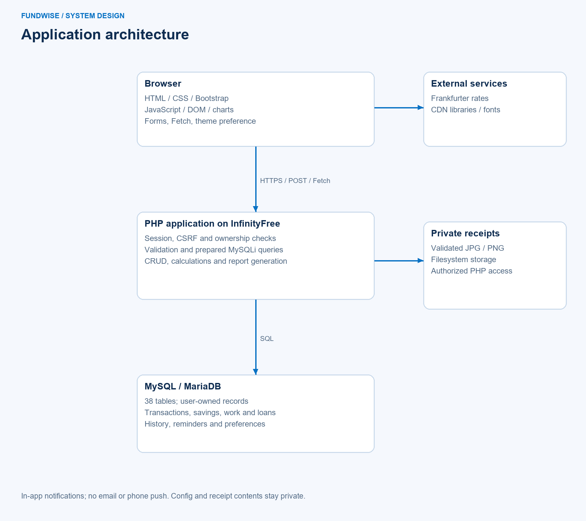

# Fundwise: technical project documentation

A Web-Based Income, Expense, and Savings Planning System  
Individual Web Systems Technology final project  
Developer: Daeniel Abujen / Daeniel528811  
Prepared from the current implementation on November 5, 2026 (Asia/Manila)

This is a reconstructed technical document, not proof of an earlier submission or instructor approval. The student must verify school formatting, student ID, section and instructor details, execute the remaining deployment checks and explain the implementation personally.

## Chapter 1 - Introduction

### Background and problem
Individuals may record income, expenses, saving targets and repayment notes separately. Gross work receipts can hide job-related costs, budgets can be difficult to compare with actual expenses, and planned purchases can overlook obligations. Fundwise centralizes user-entered records and provides views and conditional calculations to help users review those questions.

### Objectives
Provide a responsive account-based web application with user-owned financial CRUD, reports and interactive planning. Demonstrate HTML/CSS/JavaScript, Fetch/API requests, PHP processing, MySQL storage, authentication, validation, modern browser features, deployment, version control and documentation. Evaluate correctness and usability without claiming unmeasured financial outcomes.

### Scope and limitations
Core functions include transactions, categories, budgets, savings, work earnings, habit comparisons, purchase scenarios and manual debts/loans. Target users are individuals, including those with multiple income sources; there is one regular-user role. No administrator panel, bank synchronization, asset valuation, full net-worth statement, investment accounting, lender amortization engine or loans-receivable register is included. Money movements in savings/debt registers are not automatically posted to the cash ledger. In-app reminders and recovery codes are the available notification/recovery mechanisms; no email verification/reset or phone push service is configured.

## Chapter 2 - System design

### Architecture
The browser renders HTML/CSS and JavaScript supplied by PHP pages. Standard forms submit POST requests; Fetch handles asynchronous baseline previews, reminders, theme preferences and reference currency requests. PHP checks sessions, tokens, ownership and input before executing prepared MySQLi queries. MySQL/MariaDB stores user-owned records. The currency converter uses Frankfurter; static UI libraries/fonts are loaded from CDNs. Receipt files are stored privately on the hosting filesystem and retrieved through an authorized PHP route.

### Use cases and flow
The regular user registers, signs in, maintains personal records, reviews budgets/savings, analyzes work and habit data, plans purchases, records repayments, manages reminders, exports reports and logs out. A typical mutation passes authentication, CSRF/replay validation, owner-scoped lookup and input/business checks before a transaction is committed or a safe error returned. The source and image diagrams are in `docs/diagrams` and explained in `SYSTEM_DESIGN.md`.

### Database and interface
The clean schema contains 38 tables with 10 physical foreign-key constraints. Additional ownership/reference relationships are enforced in application queries; the logical ERD must not be interpreted as physical RLS or universal database FK enforcement. `DATA_DICTIONARY.md` lists all fields and keys. The interface uses shared sidebar/header chrome, blue/navy/cyan primary banners, rounded cards, responsive forms and an alternate dark theme. Synthetic screenshots document existing pages; they are not newly invented wireframes or proof of live deployment.

## Chapter 3 - Development

### Front end and interactivity
Bootstrap provides the responsive grid and dialogs/navigation patterns, with project CSS for spacing, hierarchy and theme surfaces. JavaScript uses const/let, arrow functions, array methods, template strings, modules, Promises and async/await. DOM events drive currency searching/swapping, previews, itemized expense rows, chart updates, password visibility, theme persistence and reminders. Keyboard focus and descriptive labels are included in reviewed controls; a full accessibility audit remains outside the recorded test evidence.

### Back end and API communication
PHP/MySQLi performs registration, password verification, sessions, validation, user-specific CRUD and report generation. Shared includes provide session/auth checks, cent-based input helpers, tokens, history and financial calculations. `api/theme.php` accepts a token-protected preference mutation. `api/reminder-poll.php` checks due notices for the authenticated user without extending otherwise idle human activity. Money Lab supplies GET JSON previews and per-day reviews scoped to owned categories/experiments. Currency conversion retrieves public reference rates and does not alter transactions.

### Financial behavior
Recorded cash flow is income minus expenses; saving deposits minus withdrawals are separate. Budget spending uses qualifying category transactions in that budget's date range. Money Lab combines an explicit category/optional label with reviewed prior-period baselines and day confirmations; a title or transaction description does not identify spending automatically. Purchase Map evaluates supplied balances and commitments, saving immutable assumptions without creating transactions. Work net equals gross less entered costs; recorded time excludes breaks and includes specified extra work time. Overnight sessions are grouped by start date, while actual receipt/payment transactions retain their own dates.

### Debts, loans and modern features
The debt register stores principal, actual payment components and next-due information. Reviewed plans split remaining principal across 1-60 monthly installments, clamp short months without date drift and preserve cent rounding in the last installment. User-entered interest and fees are not calculated rates. Partial payments preserve unpaid components; voids restore them. Changes use owner and version checks. Theme persistence, charts, validated file upload and in-system notifications satisfy more than three available modern-feature categories. No AI inference feature, installable PWA or offline caching is claimed.

## Chapter 4 - Testing

### Method and results
The recovered HEAD was tested in a separate local checkout with a clean database imported from the public structure-only schema. The November 5 import produced 38 tables and zero initial rows with foreign key checks enabled. Backend/calculation suites were repeated: 84 regression, 55 prior-feature, 38 reminder, 61 Update2 and 17 additional edge checks passed, totaling 255 checks including test-account setup. These are checks, not 255 independently assessed security weaknesses.

Earlier November 4 browser evidence covers 68 page-width checks and 9 expanded-form checks, plus interactions, with no recorded JavaScript exceptions. The source being recovered is unchanged application code; new verification also checks installation completeness and public-repository hygiene. Safe result summaries are included under `docs/testing`; private fixtures/configs are excluded.

### Representative cases
| Test | Expected result | Recorded result |
| --- | --- | --- |
| Cross-account record mutation | Other user's record unchanged | Passed reviewed cases |
| CSRF/request replay | Reject before duplicate write | Passed reviewed cases |
| Overnight shift and break | Correct hours/start date | Passed reviewed cases |
| Experiment unmatched/unclassified spending | Accurate scope, no false confirmation | Passed reviewed cases |
| Three-way principal split | Exact cent conservation | Passed reviewed cases |
| Partial payment and void | Unpaid due/restored amount accurate | Passed reviewed cases |
| Principal repaid, charges remain | Scheduled balance remains visible | Passed reviewed cases |
| Clean database import | Complete structure, no user data | Passed November 5 |

### Outstanding evaluation
The exact required viewport dimensions (1366x768, 768x1024, 375x667), deployed receipt rules, actual hosting upload/version, keyboard/screen-reader behavior and live API error paths must be executed and recorded by the student. No formal participant usability study, independent penetration test or improvement in financial habits has been established. `TESTING.md` separates expected manual outcomes from completed automated evidence.

## Chapter 5 - Deployment

### Hosting and procedure
The project's public entry point is https://fundwise-ph.free.je/auth/login.php on InfinityFree. PHP/MySQL hosting is necessary; a static-only host cannot execute the backend. For a new installation, create an empty database and import `database/database.sql`. Existing users apply only missing additive migrations. Upload application folders and index.php to root htdocs, privately configure the actual database credentials in includes/config.php and set BASE_URL to an empty string. Keep receipts and .htaccess access rules. Exclude .git, SQL, tests, documentation and backups from the public web root.

### Challenges and solutions
Database connection error 2002 requires checking the supplied MySQL host and hosting-side service availability rather than inventing credentials. A stale interface requires verifying matching assets were replaced and refreshing caches. Folder-manager move failures require reading the actual error and, where needed, copying files within existing destination folders. Missing tables require importing the appropriate additive migration into the correct database. Expired form tokens require fresh forms and consistent sessions; disabling CSRF is not a solution. CDN/API outages need clear feedback and honest fallbacks.

### Git recovery and release boundary
The repository's four original commits are preserved. Actual saved code snapshots were recovered on November 5 with current timestamps and meaningful messages. This does not recreate missing contemporaneous development commits. Recovery provenance, source snapshots and caveats are documented. A Git push does not itself update the hosted site; the student must separately verify the uploaded version and complete the live checklist.

## Chapter 6 - Conclusion

Fundwise integrates the course's principal web layers in a manual personal-finance application: responsive UI, JavaScript interaction, APIs, PHP, SQL, authentication, CRUD and deployment-oriented source organization. Testing supports specific implemented behavior and installation completeness. The system's planning tools remain conditional on accurate user-entered data and do not provide comprehensive accounting, automatic cash reconciliation or guaranteed financial outcomes.

The recovery process illustrates why version control should happen throughout development: saved packages can preserve code changes, but they cannot retroactively establish when commits occurred. Future work should prioritize regular focused commits, independent security/accessibility review, measured user-task evaluation and clearer financial reconciliation before expanding scope. Email/push, broader reconciliation or assets should be separate reviewed projects rather than implied capabilities.

The student remains responsible for understanding every submitted function, demonstrating changes during defense, verifying academic metadata and preparing the presentation and video. AI assistance was used in implementation/refinement, test support and documentation; it must not be used to answer the actual defense.
