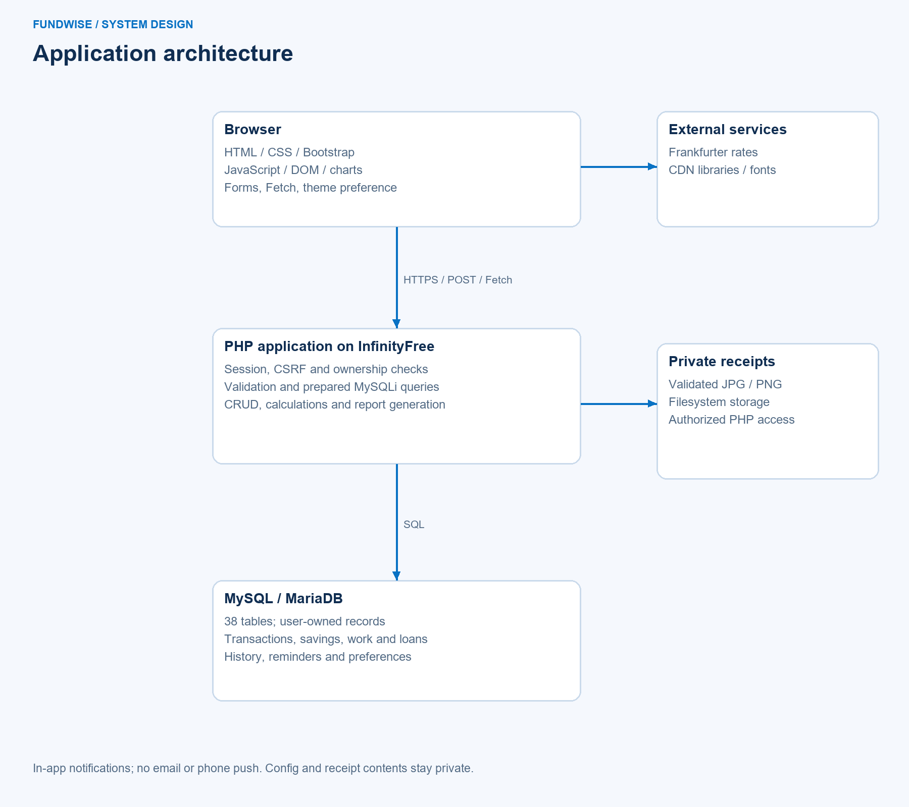
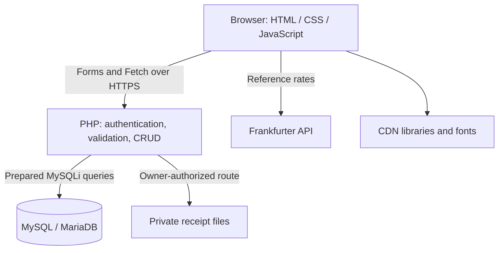
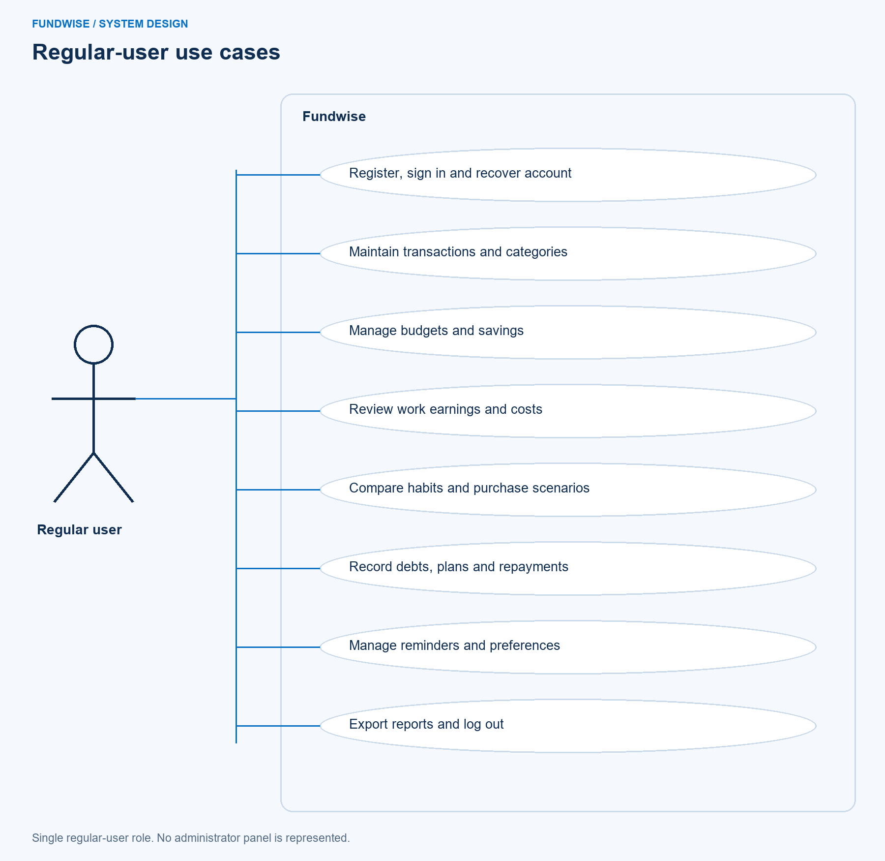
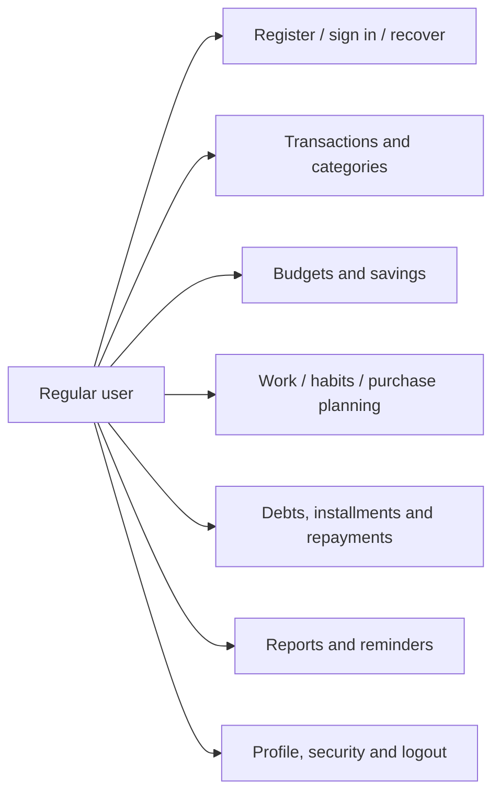
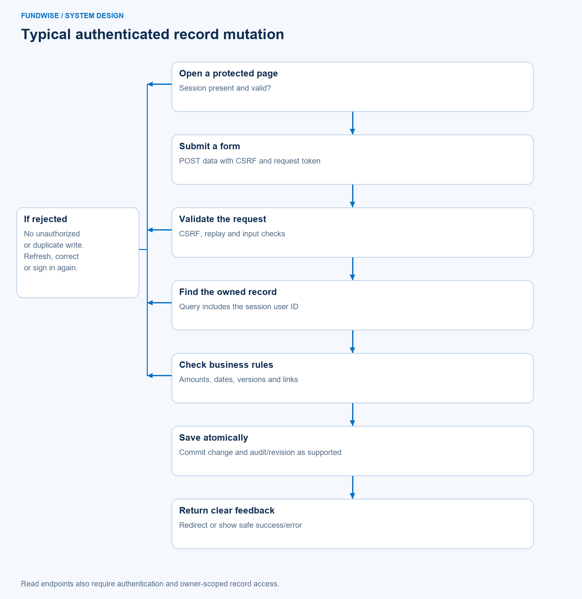
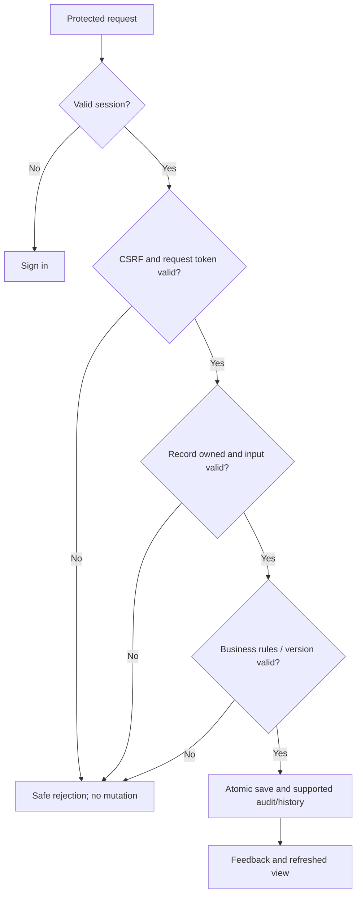
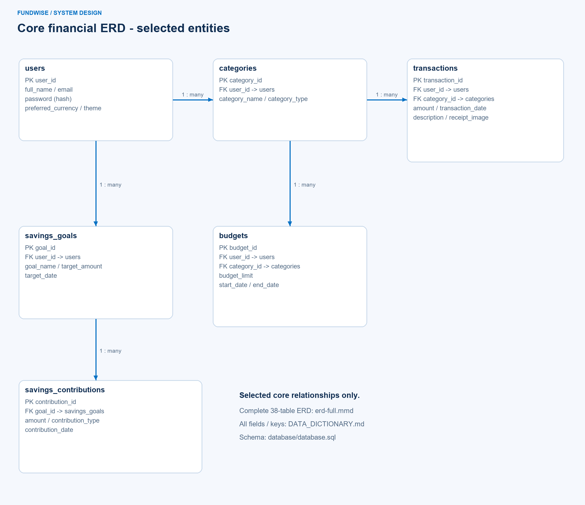

# System design

Diagrams reflect the current implementation, reconstructed November 5, 2026. The current system has one regular-user role. These are design explanations, not evidence of an earlier approved design submission.

## Architecture

## Use cases

## Record mutation flow

## ERD and physical constraints

The PNG is a selected core view, not the full schema. The [complete 38-table ERD source](diagrams/erd-full.mmd) lists all fields and identifies physical FKs versus application-only references. The [database dictionary](DATA_DICTIONARY.md) and clean SQL are authoritative for actual column types, keys and the ten physical foreign-key constraints. Many extension tables rely on PHP ownership/reference checks. A relationship in the logical ERD does not mean a database RLS policy or physical FK exists.

Editable Mermaid sources are supplied with the PNGs. For the complete ERD, open erd-full.mmd in a Mermaid-capable viewer and export at a readable size for submission; do not shrink all 38 tables into a single unreadable slide.

## Interface references

The published screenshot folder shows the existing implementation using synthetic local test data, explicitly approved for publication by the project owner. Actual pages include shared responsive navigation, blue/navy/cyan banners, forms, summary cards, charts, clear feedback and dark/light modes. These are implementation references, not invented evidence of historical wireframe work.
